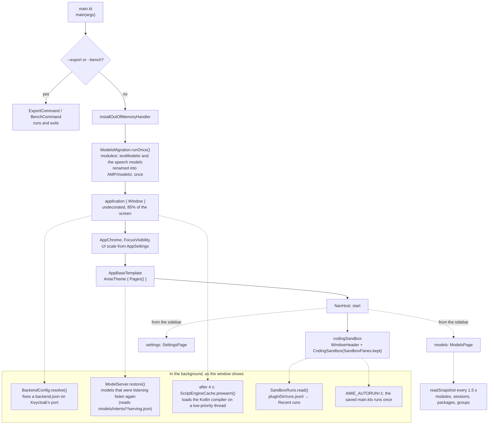
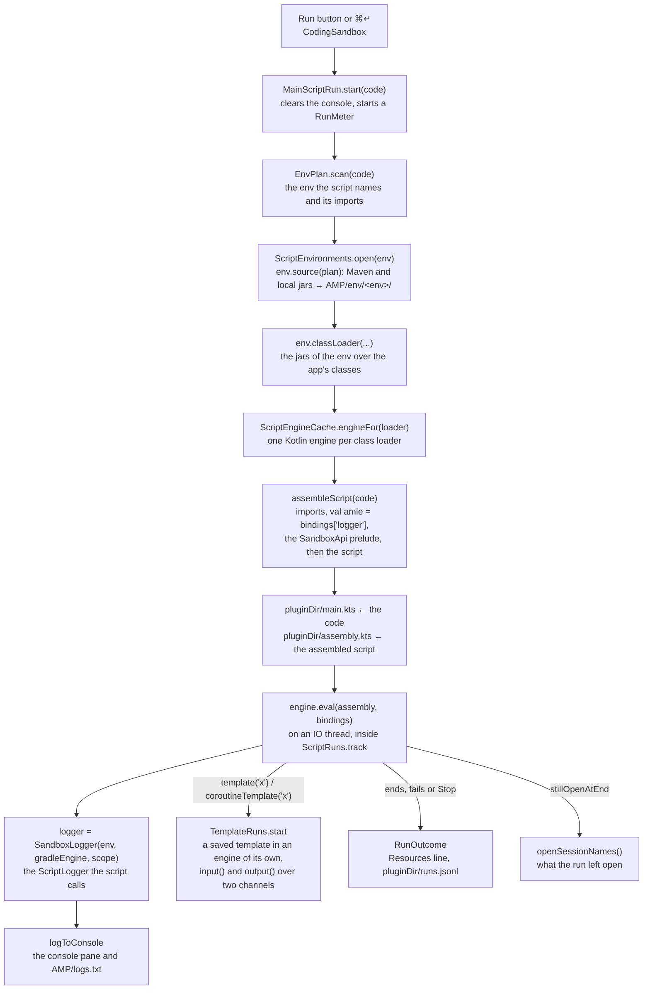
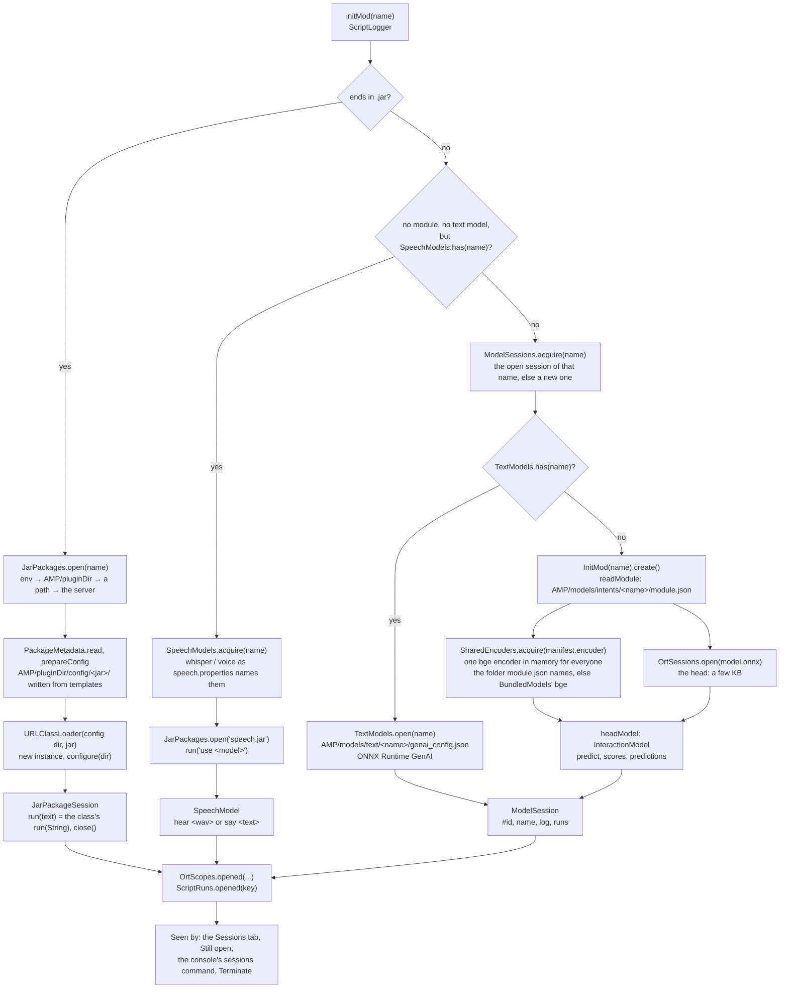
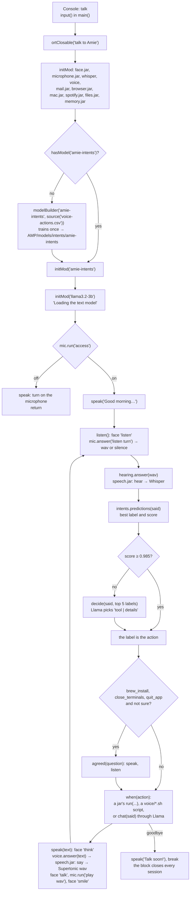

# How the app works today

Four pictures of what the code does on 2026-11-03: how the app starts, what a Run does, how `initMod(name)`
becomes a session, and the talk loop of `voice/talk-to-amie.kts`. Every box is a file; the table under each
diagram links it. Paths are under `amieApplication/desktopApp/src/main/kotlin/org/example/project/` unless
written in full. The diagrams were checked against a real run (the console's `logs.txt`), not against a plan.

## 1. Start

| Box | File | What it does |
|---|---|---|
| `main(args)` | [main.kt](../amieApplication/desktopApp/src/main/kotlin/org/example/project/main.kt) | Hands `--export` and `--bench` to their commands, installs the out-of-memory handler, opens the window |
| `ModelsMigration.runOnce()` | [amp/ModelsMigration.kt](../amieApplication/desktopApp/src/main/kotlin/org/example/project/amp/ModelsMigration.kt), [amp/ModelFolders.kt](../amieApplication/desktopApp/src/main/kotlin/org/example/project/amp/ModelFolders.kt) | Moves each kind of model into `AMP/models/` with one atomic rename when its old folder is there and the new one is not; with both there it moves nothing and says which to tidy; it points `speech.properties` at `models/speech`. `ModelFolders` is the one owner of the paths every reader uses |
| `ExportCommand`, `BenchCommand` | [export/ExportCommand.kt](../amieApplication/desktopApp/src/main/kotlin/org/example/project/components/terminal/window/controller/export/ExportCommand.kt), [bench/BenchCommand.kt](../amieApplication/desktopApp/src/main/kotlin/org/example/project/bench/BenchCommand.kt) | The command-line modes; no window |
| `application { Window }` | [main.kt](../amieApplication/desktopApp/src/main/kotlin/org/example/project/main.kt) | The undecorated window, its tray icon when closed while a script runs, the resize edges |
| `AppChrome`, `FocusVisibility` | [components/ui/viewport/AppChrome.kt](../amieApplication/desktopApp/src/main/kotlin/org/example/project/components/ui/viewport/AppChrome.kt), [FocusRing.kt](../amieApplication/desktopApp/src/main/kotlin/org/example/project/components/ui/viewport/FocusRing.kt) | What every page's header gets from the window (drag, minimize, maximize, close) and the keyboard focus ring |
| `AppBaseTemplate` | [components/render/templates/AppBaseTemplate.kt](../amieApplication/desktopApp/src/main/kotlin/org/example/project/components/render/templates/AppBaseTemplate.kt) | The theme and the `NavHost`: `start` goes straight to `codingSandbox`; `models`, `settings`, `login` and the device routes are the rest |
| `CodingSandbox` | [sandbox/CodingSandbox.kt](../amieApplication/desktopApp/src/main/kotlin/org/example/project/components/terminal/window/controller/sandbox/CodingSandbox.kt) | The sandbox page: editor, console, the tool windows; `SandboxPanes.kept` holds the run that outlives the page |
| `ModelsPage` | [models/ModelsPage.kt](../amieApplication/desktopApp/src/main/kotlin/org/example/project/components/terminal/window/controller/models/ModelsPage.kt) | The Models page, which reads `readSnapshot` every 1.5 s or slower when a read is slow (`pollDelay`) |
| `BackendConfig.resolve()` | [backend/BackendConfig.kt](../amieApplication/desktopApp/src/main/kotlin/org/example/project/backend/BackendConfig.kt) | Corrects `AMP/backend.json` before any backend call; nothing is called at start |
| `ModelServer.restore()` | [runtime/ModelServer.kt](../amieApplication/desktopApp/src/main/kotlin/org/example/project/components/terminal/window/controller/runtime/ModelServer.kt) | Starts the listener of every model whose `serving.json` says it was listening |
| `ScriptEngineCache.prewarm()` | [script/ScriptRuntime.kt](../amieApplication/desktopApp/src/main/kotlin/org/example/project/components/terminal/window/controller/script/ScriptRuntime.kt) | After `PREWARM_DELAY_MS` (4 s) loads the Kotlin compiler so the first Run answers in a moment; off with `-Damie.prewarm=false` |
| `SandboxRuns.read()` | [sandbox/SandboxRuns.kt](../amieApplication/desktopApp/src/main/kotlin/org/example/project/components/terminal/window/controller/sandbox/SandboxRuns.kt) | The last 20 runs for the Recent runs list |
| `AMIE_AUTORUN` | [sandbox/CodingSandbox.kt](../amieApplication/desktopApp/src/main/kotlin/org/example/project/components/terminal/window/controller/sandbox/CodingSandbox.kt) | With `AMIE_AUTORUN=1` the first sandbox shown presses Run once |
| `readSnapshot` | [models/ModelsSnapshot.kt](../amieApplication/desktopApp/src/main/kotlin/org/example/project/components/terminal/window/controller/models/ModelsSnapshot.kt) | One read of everything the Models page shows |

What a start marks on standard output with `-Damie.timing=true`: `main entered`, `window content composed`,
`sandbox composed`, `sandbox drawn`, `models page read` ([StartupTiming.kt](../amieApplication/desktopApp/src/main/kotlin/org/example/project/StartupTiming.kt)).

## 2. A run

| Box | File | What it does |
|---|---|---|
| Run | [sandbox/CodingSandbox.kt](../amieApplication/desktopApp/src/main/kotlin/org/example/project/components/terminal/window/controller/sandbox/CodingSandbox.kt) | The button and the shortcut both call `MainScriptRun.start` |
| `MainScriptRun` | [script/MainScriptRun.kt](../amieApplication/desktopApp/src/main/kotlin/org/example/project/components/terminal/window/controller/script/MainScriptRun.kt) | The one run of `main.kts`; it belongs to the app, so leaving the page does not end it |
| `EnvPlan`, `ScriptEnvironments`, `ScriptEnvironment` | [envBuilder/ScriptEnvironment.kt](../amieApplication/desktopApp/src/main/kotlin/org/example/project/components/terminal/window/controller/envBuilder/ScriptEnvironment.kt) | The env named by `settings { env = … }` or the default; its `env.lock.json`, Maven resolution, the class loader |
| `ScriptEngineCache` | [script/ScriptRuntime.kt](../amieApplication/desktopApp/src/main/kotlin/org/example/project/components/terminal/window/controller/script/ScriptRuntime.kt) | One engine per class loader, the Gradle settings engine, `prewarm` |
| `assembleScript` | [script/ScriptRuntime.kt](../amieApplication/desktopApp/src/main/kotlin/org/example/project/components/terminal/window/controller/script/ScriptRuntime.kt) | What the engine really evaluates; `ScriptErrors` maps its line numbers back to `main.kts` |
| `SandboxApi.prelude()` | [script/SandboxApi.kt](../amieApplication/desktopApp/src/main/kotlin/org/example/project/components/terminal/window/controller/script/SandboxApi.kt) | One delegate line per API entry, so a script writes `initMod(...)` and not `amie.initMod(...)` |
| `SandboxLogger` | [script/SandboxLogger.kt](../amieApplication/desktopApp/src/main/kotlin/org/example/project/components/terminal/window/controller/script/SandboxLogger.kt) | The `ScriptLogger` of a run: console lines, `input()`, the builders |
| `ScriptLogger` | [script/ScriptLogger.kt](../amieApplication/desktopApp/src/main/kotlin/org/example/project/components/terminal/window/controller/script/ScriptLogger.kt) | The script API: `initMod`, `sessionMod`, `group`, `modelBuilder`, `fineTune`, `serve`, `shell`, the `ort*` blocks |
| `logToConsole` | [console/ConsoleLog.kt](../amieApplication/desktopApp/src/main/kotlin/org/example/project/components/terminal/window/controller/console/ConsoleLog.kt) | Every console line, to the pane and to `AMP/logs.txt` |
| `TemplateRuns` | [script/BackgroundTemplates.kt](../amieApplication/desktopApp/src/main/kotlin/org/example/project/components/terminal/window/controller/script/BackgroundTemplates.kt) | Background templates: `template(name)` ends with the run, `coroutineTemplate(name)` goes on |
| `ScriptRuns` | [runtime/ScriptRuns.kt](../amieApplication/desktopApp/src/main/kotlin/org/example/project/components/terminal/window/controller/runtime/ScriptRuns.kt) | Tracks the run's thread: its cpu, allocation and the sessions it opened |
| `RunOutcome`, `SandboxRuns` | [runtime/RunResources.kt](../amieApplication/desktopApp/src/main/kotlin/org/example/project/components/terminal/window/controller/runtime/RunResources.kt), [sandbox/SandboxRuns.kt](../amieApplication/desktopApp/src/main/kotlin/org/example/project/components/terminal/window/controller/sandbox/SandboxRuns.kt) | The figures of the run and the record in `pluginDir/runs.jsonl` |

The console says `Running pluginDir/main.kts` first, and the Resources line last, both at the internal level, off at
start, so the console shows only what the script logs. A failure's lines begin with their place in `main.kts`.

## 3. `initMod(name)`: a name becomes a session

| Box | File | What it does |
|---|---|---|
| `initMod` | [script/ScriptLogger.kt](../amieApplication/desktopApp/src/main/kotlin/org/example/project/components/terminal/window/controller/script/ScriptLogger.kt) | The three branches above, in that order |
| `JarPackages.open` | [pluginEngine/JarPackages.kt](../amieApplication/desktopApp/src/main/kotlin/org/example/project/components/terminal/window/controller/pluginEngine/JarPackages.kt) | Resolves the jar, checks its metadata, makes the instance, returns the session |
| `PackageMetadata` | [pluginEngine/PackageMeta.kt](../amieApplication/desktopApp/src/main/kotlin/org/example/project/components/terminal/window/controller/pluginEngine/PackageMeta.kt) | What a jar says it needs, and the config folder `AMP/pluginDir/config/<jar>/` |
| `JarPackageSession` | [pluginEngine/JarPackages.kt](../amieApplication/desktopApp/src/main/kotlin/org/example/project/components/terminal/window/controller/pluginEngine/JarPackages.kt) | The package behind `run`, `answer`, `getStatus`, `close`; every call is logged to `<jar>.sessions.log` |
| `SpeechModels`, `SpeechModel` | [runtime/SpeechModels.kt](../amieApplication/desktopApp/src/main/kotlin/org/example/project/components/terminal/window/controller/runtime/SpeechModels.kt) | Whisper and the voices as models: each is one session of `speech.jar` |
| `speech.jar` | `/Users/samuel/Documents/GitHub/amie-packages/speech` | Reads its models where `models=` in `speech.properties` says, which the move keeps at `AMP/models/speech` |
| `ModelSessions` | [runtime/ModelSessions.kt](../amieApplication/desktopApp/src/main/kotlin/org/example/project/components/terminal/window/controller/runtime/ModelSessions.kt) | A model has one session: the open one is reused, with a `reused` line in its log |
| `TextModels`, `TextModel` | [runtime/TextModels.kt](../amieApplication/desktopApp/src/main/kotlin/org/example/project/components/terminal/window/controller/runtime/TextModels.kt) | Llama and Qwen from `AMP/models/text/<name>/`, generated with ONNX Runtime GenAI |
| `InitMod`, `headModel` | [integrations/amiePilot/BertBaseNER.kt](../amieApplication/desktopApp/src/main/kotlin/org/example/project/components/terminal/integrations/amiePilot/BertBaseNER.kt) | Opens an intent model: the manifest, the shared encoder, the head |
| `readModule`, `modulesDir` | [modules/AmpModules.kt](../amieApplication/desktopApp/src/main/kotlin/org/example/project/components/terminal/window/controller/modules/AmpModules.kt) | `AMP/models/intents/<name>/`: `model.onnx`, `module.json`, `metrics.json`, `versions/` |
| `SharedEncoders` | [integrations/amiePilot/SharedEncoders.kt](../amieApplication/desktopApp/src/main/kotlin/org/example/project/components/terminal/integrations/amiePilot/SharedEncoders.kt) | One loaded encoder per folder, counted holders, closed by the last release |
| `BundledModels` | [integrations/amiePilot/BundledModels.kt](../amieApplication/desktopApp/src/main/kotlin/org/example/project/components/terminal/integrations/amiePilot/BundledModels.kt) | Where `models/bert/` and `models/bert/bge/` are: `AMIE_MODELS_DIR`, the packaged resources, `AMP/models/bert`, the checkout's copy. `resolveEncoder` keeps the folder a manifest names when it exists, else the bundled one of that name |
| `OrtSessions` | [modelLoaders/OrtSessions.kt](../amieApplication/desktopApp/src/main/kotlin/org/example/project/components/terminal/window/controller/modelLoaders/OrtSessions.kt) | Every ONNX Runtime session, named, for `ortSessions()` |
| `OrtScopes` | [modules/OrtScopes.kt](../amieApplication/desktopApp/src/main/kotlin/org/example/project/components/terminal/window/controller/modules/OrtScopes.kt) | `ortClosable { }` closes what its block opened; `ortStatic`, `ortRequired`, `ortLimited` keep it under a name |
| `ScriptRuns.opened` | [runtime/ScriptRuns.kt](../amieApplication/desktopApp/src/main/kotlin/org/example/project/components/terminal/window/controller/runtime/ScriptRuns.kt) | The run notes the key (`model:#id`, `package:#id`, `group:#id`) for its Resources line |
| The Sessions tab, Still open | [tabs/SessionsTab.kt](../amieApplication/desktopApp/src/main/kotlin/org/example/project/components/terminal/window/controller/tabs/SessionsTab.kt), [console/ConsoleSessions.kt](../amieApplication/desktopApp/src/main/kotlin/org/example/project/components/terminal/window/controller/console/ConsoleSessions.kt) | `openSessions()` lists `ModelSessions.all`, `JarPackages.open`, the swarms, the snapshots and the jobs; Terminate closes one |

`sessionMod(name)` is not in the picture: it takes a snapshot of the head through `SharedModels` and opens no
session. `group(name)` opens a `ModelSwarm` over the group's models through `ModelGroups`.

## 4. The talk: `voice/talk-to-amie.kts`

| Box | File | What it does |
|---|---|---|
| The template | [voice/talk-to-amie.kts](../voice/talk-to-amie.kts) | `main()` waits for `talk` on the console, `talk()` is the loop |
| `ortClosable` | [modules/OrtScopes.kt](../amieApplication/desktopApp/src/main/kotlin/org/example/project/components/terminal/window/controller/modules/OrtScopes.kt) | Everything opened in the block is closed when it ends, however it ends |
| `face.jar` | `amie-packages/face` | The floating face: `load`, `listen`, `think`, `talk`, `smile`, `sleep` |
| `microphone.jar` | `amie-packages/microphone` | `access`, `listen turn` (records until a pause; `silence` when nothing was said), `play <wav>` |
| `whisper`, `voice` | [runtime/SpeechModels.kt](../amieApplication/desktopApp/src/main/kotlin/org/example/project/components/terminal/window/controller/runtime/SpeechModels.kt) | The Whisper and Supertonic sessions of `speech.jar`, named in `speech.properties` |
| `amie-intents` | [jetbrainDLBuilder/JetBuilder.kt](../amieApplication/desktopApp/src/main/kotlin/org/example/project/components/terminal/window/controller/jetbrainDLBuilder/JetBuilder.kt) | Built once from `AMP/voice-actions.csv` by `modelBuilder`; after that `initMod` opens it like any intent model |
| `llama3.2-3b` | [runtime/TextModels.kt](../amieApplication/desktopApp/src/main/kotlin/org/example/project/components/terminal/window/controller/runtime/TextModels.kt) | `think(system, user, tokens, temperature)` sends a chat request as JSON to `answer` |
| The actions | [voice/talk-to-amie.kts](../voice/talk-to-amie.kts), [voice/scripts](../voice/scripts) | `mail.jar`, `browser.jar`, `mac.jar`, `spotify.jar`, `files.jar`, `memory.jar`, and the shell scripts through `shellScript(...).patchBy(::explain)` |

What `logs.txt` shows of one turn, in this order: `Listening`, the `hear` line of `speech.jar`, `You: … -> action`,
the package's `run` line, `Amie: …`, the `say` line of `speech.jar`, the `play` line of `microphone.jar`.

## Where the models are in `AMP/`

| Model | Folder (since November 2026; the one before in brackets) | Read by |
|---|---|---|
| The NER model and the bge encoder | `AMP/models/bert/`, `AMP/models/bert/bge/` | `BundledModels` |
| Trained intent models | `AMP/models/intents/<name>/` (`AMP/modules/`) | `AmpModules.modulesDir`, from `ModelFolders` |
| Llama, Qwen | `AMP/models/text/<name>/` (`AMP/textModels/`) | `TextModels.dir`, from `ModelFolders` |
| Whisper, Supertonic | `AMP/models/speech/<name>/` (`AMP/pluginDir/config/speech/models/`) | `speech.jar`, through `SpeechModels`; `speech.properties` names the folder |

`ModelsMigration` moves an older install into this layout at start, one rename a kind, as [The AMP folder](amp-folder.md#the-models-folder) says. See that page for everything else the app writes.
