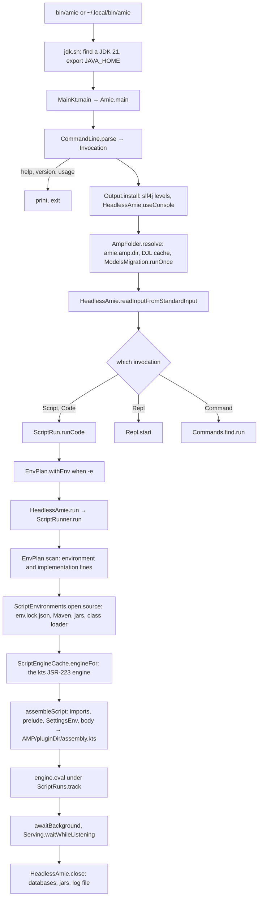

# The code of amie: what is where, and why

A reader's map of the amieCli repository: the two Kotlin modules, every package of the engine with what it is for and
who uses it, how a process starts and runs a script, and the state it keeps. Written for learning the code, not for
using amie; [the amie guide](../amie/README.md) covers the use.

## Size

| Part | Files | Lines |
|---|---|---|
| `amie/src/main` (the interpreter) | 13 | 1 785 |
| `amie/src/test` | 5 | 428 |
| `runtime/src/main` (the engine) | 131 | 25 475 |
| Gradle build files (`*.kts`) | 7 | 679 |
| Shell scripts (`bin/amie`, `install.sh`, `jdk.sh`, `scripts/setup.sh`, the voice scripts) | 9 | 225 |
| `docs/*.md` | 23 | 5 831 |
| The learn book, `amie/learn/index.html` | 1 | 567 |
| `voice/` (scripts and data for the talk starter) | 9 | 1 751 |

About 27 200 lines of Kotlin, of which the interpreter proper is about 6 %. Everything heavy is the engine, which
is the script runtime of the amie pilot desktop app, taken out of it unchanged in November 2026.

## Layout

```
amie/                 the interpreter, Gradle module :amie, package org.amie.cli
  src/main/kotlin/org/amie/cli/
  src/test/kotlin/org/amie/cli/
  learn/index.html    the learn book, copied into the jar and opened by amie docs
  build.gradle.kts    the application plugin; jdk.sh is spliced into the start script
  install.sh, jdk.sh  install on the PATH; find (or install) a JDK 21
runtime/              the engine, Gradle module :runtime, package org.example.project
  src/main/kotlin/org/example/project/
scripts/              setup.sh, which downloads the encoder and voice models into the AMP folder
bin/amie              runs amie from the checkout, building it first when the sources changed
docs/                 this documentation; most pages were written for the desktop app
voice/                the talk-to-amie scripts: intent model plus text model plus speech
settings.gradle.kts   the two modules; build.gradle.kts the shared plugin versions; gradle/ the wrapper and
                      libs.versions.toml, the version catalog both modules read
```

The dependency runs one way: `amie` depends on `runtime`, `runtime` depends on nothing of amie. The desktop app, in
its own repository, depends on the same `runtime` module.

## The interpreter, `amie/src/main/kotlin/org/amie/cli/`

| File | Lines | What it holds |
|---|---|---|
| `Main.kt` | 70 | `Amie.main(args)`: parse, print help or version, else install the console, settle the AMP folder, dispatch |
| `CommandLine.kt` | 179 | `CommandLine.parse` into an `Invocation`: `Repl`, `Script`, `Code`, `Command`, `Help`, `Version`, `Usage`; the usage text |
| `Output.kt` | 89 | Where console lines go: stdout, errors on stderr, internal lines only with `-v`; the slf4j properties |
| `AmpFolder.kt` | 52 | The AMP folder to work in: `--amp`, else `AMIE_AMP_DIR`, else the user's data folder; the DJL cache; the models migration |
| `ScriptRun.kt` | 63 | A script as main.kts: read a file, a project or a starter, pass its arguments, run it, wait for the background, keep serving |
| `Repl.kt` | 268 | The prompt: JLine line editing, `ReplInput` deciding when a block is complete, the colon commands, `:help` |
| `Commands.kt` | 315 | The `Command` base class (actions, flags, help), `Commands.all`, and `run`, `new`, `examples`, `sessions`, `envs`, `templates` |
| `ModelCommands.kt` | 418 | `models` (with `info` and `remove` for every kind), `groups`, `packages`, `hf` |
| `Picker.kt` | 114 | The arrow-key list `hf import` picks files from: up and down, space takes or leaves, Enter, `n` leaves; redrawn in place, wrapped to the terminal |
| `Starters.kt` | 49 | The starter scripts, from the engine's `SandboxExamples`, seeded into `AMP/templates` on first use |
| `Learn.kt` | 69 | `amie docs`: the book copied to `AMP/learn` and opened in the browser |
| `Banner.kt` | 42 | The banner and the version line |
| `Style.kt` | 57 | ANSI colours for the prompt, errors, dimmed lines |

Nothing in this module trains, runs or serves a model. It parses, prints and calls the engine through one facade,
`HeadlessAmie` in the runtime's `script` package, plus a few objects it reads directly (`ModelFolders`, `ScriptEnvironments`,
`ModelServer`, `TextModels`, `SpeechModels`, `HfImports`, `ScriptTemplates`, `SandboxApi`).

## The engine, `runtime/src/main/kotlin/org/example/project/`

The package names still carry the desktop app's history: everything under `components/terminal/window/controller/`
was the controller behind the app's terminal window. Below, `C/` stands for that folder.

### Live packages, what every script run touches

| Package | Lines | What it is for | Key files |
|---|---|---|---|
| `C/script` | 3 209 | The script engine and the facade. `HeadlessAmie` is what amie calls; `ScriptRuntime` assembles and compiles a script with Kotlin's JSR-223 engine; `ScriptLogger` is the whole script API (`initMod`, `modelBuilder`, `group`, `database`, `huggingFace`, `log`, ...) and `SandboxLogger` its implementation; `SandboxApi` the catalogue of those functions, from which the prelude and `:api` are made; `ConsoleSession` the one interpreter the prompt's lines share; `BackgroundTemplates` the runs (`TemplateRuns`); `ScriptTemplates` the saved scripts of `AMP/templates` | `HeadlessAmie.kt`, `ScriptRuntime.kt`, `ScriptLogger.kt`, `SandboxLogger.kt`, `SandboxApi.kt`, `ConsoleSession.kt`, `BackgroundTemplates.kt`, `ScriptTemplates.kt`, `ScriptErrors.kt`, `ScriptInput.kt` |
| `C/console` | 545 | Where a console line goes without a window: `logToConsole` writes it to the installed console and to `AMP/logs.txt`; the last error lines; whether a typed block is complete; the open sessions; a memory watch | `ConsoleLog.kt`, `ErrorTerminal.kt`, `ConsoleBlocks.kt`, `OpenSessions.kt`, `MemoryWatch.kt` |
| `C/envBuilder` | 739 | A script's env: `AMP/env/<name>` with the Maven packages and jars it sources, resolved Gradle-style from Maven Central into a shared cache and pinned in `env.lock.json`; `EnvPlan.scan` reads the `environment(...)` and `implementation(...)` lines before a script compiles | `ScriptEnvironment.kt`, `SettingsEnv.kt` |
| `C/runtime` | 1 944 | Open model sessions and their lifecycle (`ModelSessions`: one session per model name), the HTTP model server (`ModelServer`, the JDK's `HttpServer`), the text models (`TextModels`, ONNX Runtime GenAI) and the speech models (`SpeechModels`, through the speech package jar), and what a run opened (`ScriptRuns`) | `ModelSessions.kt`, `ModelServer.kt`, `TextModels.kt`, `SpeechModels.kt`, `ScriptRuns.kt`, `LiveModel.kt`, `RunResources.kt` |
| `C/modules` | 2 556 | The intent models on disk, called modules: `AMP/models/intents/<name>/model.onnx` with its `module.json`, registered in `modules.json`; groups of models asked together; kept versions; the metrics of a build; the ONNX session scopes (`ortClosable`, `ortStatic`) and background jobs | `AmpModules.kt`, `ModelGroups.kt`, `ModelVersions.kt`, `ModuleMetrics.kt`, `OrtScopes.kt`, `OrtJobs.kt`, `ModelJobs.kt`, `SharedModels.kt` |
| `components/terminal/integrations/amiePilot` | 939 | The model core: `InteractionModel`, the interface every model kind implements (`inference`, `getStatus`, `abilities`, `predict`, `scores`, `inBackground`, `close`, and for a pair `encoder`, `decoder`, `encode`, `decoderFeeds`, `startTokens`, `tokens`, `text`, every one a default that refuses on a single model); `Tokens` and `Encoded`, what a tokenizer and an encoder give; `InitMod`, which opens an intent model as its head plus the shared encoder; `SharedEncoders`, the reference-counted encoder sessions; `BundledModels`, where the BERT encoder is found (`AMIE_MODELS_DIR`, else `AMP/models/bert`); `Tensor` | `InteractionModel.kt`, `BertBaseNER.kt`, `SharedEncoders.kt`, `BundledModels.kt`, `Tensors.kt` |
| `C/modelLoaders` | 2 066 | ONNX Runtime sessions (`OrtSessions`) and the loaders of outside models: `imported/` opens an ONNX, TorchScript or SavedModel from `AMP/models/imported` through ONNX Runtime or DJL, `ModelFormats` scans a folder for what runs, `ModelText` reads a tokenizer and a language-model head; `builderImplement/onnxModel.kt` wraps a raw ONNX file as an `InteractionModel`; `imported/EncoderDecoderModel` is an `encoder_model.onnx` with `decoder_model.onnx` pair as two sessions plus the tokenizer, `encode`, `decoderFeeds` and `startTokens` read off the config files; `imported/Preprocessing.kt` makes the encoder's input from a file as `preprocessor_config.json` says: `Audio` reads and resamples a sound file, `LogMel` is Whisper's log-mel spectrogram, `Preprocessor.image` the resized, normalized pixels | `OrtSessions.kt`, `imported/ImportedModels.kt`, `imported/ModelFormats.kt`, `imported/DjlModel.kt`, `imported/ModelText.kt`, `imported/EncoderDecoderModel.kt`, `imported/Preprocessing.kt` |
| `C/jetbrainDLBuilder` | 3 567 | The trainer behind `modelBuilder`: preprocess, embed the texts with the encoder (cached in `AMP/cache/embeddings`), train and score candidate heads, validate, calibrate, export the head to ONNX. Despite the name it uses neither KotlinDL nor TensorFlow: `DenseNet.kt` is plain Kotlin. Fine-tuning, the label queue and calibration live here too | `JetBuilder.kt`, `FineTune.kt`, `LabelQueue.kt`, `ModelCalibration.kt`, `Preprocessor.kt`, `EmbeddingCache.kt`, `Search.kt` |
| `C/metrics` | 477 | What a build reports: ASCII charts, the model card written to `guide.md`, bootstrap confidence intervals, and `ModelRequirements`, what blocks a model from running | `MetricsCharts.kt`, `ModelCard.kt`, `ScoreIntervals.kt`, `ModelRequirements.kt` |
| `C/huggingFace` | 1 436 | The Hub: search, a repo's files sorted into what runs here (`HfPair`, an encoder and decoder folder as a menu with a default, `HfMenu` what an import offers to pick from), the download into `AMP/models/imported`, `text` or `speech`, and `PiperVoice`, which makes a raw Piper voice ready for sherpa-onnx | `HfHub.kt`, `HfRef.kt`, `HfRepo.kt`, `HfSearch.kt`, `ImportedList.kt`, `PiperVoice.kt` |
| `C/pluginEngine` | 1 520 | Package jars: found in the env, `AMP/pluginDir`, a path, the Amie server or GitHub; opened as a model or a plugin; their metadata and tests. The speech package is one of these | `JarPackages.kt`, `PackageMeta.kt`, `GitHubJars.kt`, `JarInspector.kt`, `JarInterpreter.kt` |
| `C/sourceFile` | 257 | CSV training data: reading a file, inferring its text and label columns | `DataSource.kt`, `SourceCsv.kt` |
| `C/export` | 2 095 | `amie template export`: a script packed with its models, env jars (or `require.txt` naming them with `--no-jars`) and a secrets manifest into a bundle that runs on its own; `ScriptScan`, the static scan of what a script uses, which the prompt also uses to size a line's memory | `ScriptExporter.kt`, `ScriptScan.kt`, `CompiledScripts.kt`, `BundleRunner.kt`, `ExportCommand.kt` |
| `C/databases` | 201 | `database("name")`: JDBC connections from `AMP/databases.json`, secrets as `$ENV:NAME`. amie ships no JDBC driver, so a database needs its driver in the env | `Databases.kt` |
| `C/sandbox` | 1 008 | The starter scripts (`SandboxExamples`), the record of runs in `AMP/pluginDir/runs.jsonl`, and `handleBy()`, which asks a local text model about an error | `SandboxExamples.kt`, `SandboxRuns.kt`, `AssistantModel.kt`, `AssistantPrompt.kt` |
| `C/models` | 171 | Texts shared by the script API and the app's Models page; an open session's row | `ModelWords.kt`, `SessionInfo.kt` |
| `amp` | 180 | The one owner of the `AMP/models/<kind>` paths, and the one-time move of the old folders into them | `ModelFolders.kt`, `ModelsMigration.kt` |
| `util` | 34 | `Secrets`: a secret from an environment variable, else a bundle's `secrets.env` | `Secrets.kt` |
| `C/ResponseDto.kt` | 41 | `ResponseDto`, the console line, and `LogLevel { INFO, ERROR, DATA, INTERNAL }` | |
| `AmpDirectory.kt`, `AmieBuild.kt` | 62 | `getDirectory()`, the AMP folder, fixed once per process; the version and build flags | |

### Desktop leftovers, and why they are still here

These came along with the split because something live imports them. None does useful work under amie.

| Package | Lines | What it was for | What still reaches it | Could it go? |
|---|---|---|---|---|
| `auth` | 786 | Keycloak sign-in for the app: password and browser flows, token checks, the session in `AMP/session.json` | `backend`, `settings`, and `C/export/BundleRunner.kt` for a bundle's tokens. Under amie `AuthState.user` is always empty | Yes, with the three callers made to compile without it |
| `backend` | 632 | The app's web backend: saved state, package and module uploads, error reports, site and S3 addresses | `ConsoleLog` calls `ErrorReporter.report` on every ERROR line (a no-op while nobody is signed in); `ScriptLogger.saveState/loadState/listStates` (fail without a token); `JarPackages` uses its HTTP client and `BackendConfig` addresses to fetch jars from the Amie server | Mostly. Only the jar fetch does real work; `BackendConfig` and the client could stay as a smaller thing |
| `settings` | 700 | The app's preferences and cloud sync of the AMP folder | One read, `AppSettings.current.value.assistantModel`, when a script calls `handleBy()`; that read pulls in `CloudSave`, hence `auth` and `backend` | Yes, with `handleBy` taking its model name from elsewhere |
| `data/remote/parser` | 23 | Two DTOs of `AMP/pluginDir/corePlugins.json` | `SandboxLogger.importPlugin`, which only prints the name | Yes |

The short answer to "why is the backend there": the engine logs every error through one function, and that function
also offers the line to the app's error reporting, which needs the sign-in state, which needs the backend client.
amie inherits the chain and never uses it, since no one signs in. Trimming it is a matter of giving those three
call sites a smaller target, not of untangling the engine.

### Dead files

Nothing in the repository references these; they compile and do nothing: `C/TfLiteBuilder/` (one class whose
`load()` is `TODO()`), `auth/Accounts.kt`, `amiePilot/NNHelpers.kt` (the one TensorFlow 1.15 importer, excluded from
the build on ARM machines anyway), `envBuilder/MavenCentral.kt`, `metrics/ModelValidation.kt`,
`pluginEngine/PackageCollections.kt`, `pluginEngine/Standalone.kt`, `runtime/SessionRuns.kt`, `sandbox/SandboxWelcome.kt`.

## Initialization: from the shell to a running script



Step by step, with the file and function at each:

1. **The launcher.** `bin/amie` sources `amie/jdk.sh` and rebuilds with `./gradlew :amie:installDist` when a source
   is newer than the built binary, then execs `amie/build/install/amie/bin/amie`. The installed `bin/amie` is Gradle's
   start script with `jdk.sh` spliced in by `tasks.startScripts` in `amie/build.gradle.kts`. `jdk.sh` looks, in
   order, at `AMIE_JAVA_HOME`, `JAVA_HOME`, the Mac's `java_home`, Homebrew, `~/.local/lib/jdk-21`, sdkman,
   `/usr/lib/jvm` and Gradle's downloaded JDKs, and exits with 2 when none is a 21. The JVM starts with
   `-Damie.version`, `-Djava.awt.headless=true`, `-XX:MaxRAMPercentage=35` and the main class `org.amie.cli.MainKt`.
2. **Parsing.** `Main.kt: Amie.main` calls `CommandLine.parse`. Options are `-h`, `--version`, `-i`, `-v`, `-q`,
   `-e`, `--amp`, `-c`; the first other word is looked up in `Commands.all` and becomes a `Command`, else a
   `Script`. Help, version and a usage mistake return here, before anything touches the disk.
3. **The console.** `Output.install` sets the slf4j-simple levels (the engine's loggers to warn, DJL to error, the
   sandbox logger off) and calls `HeadlessAmie.useConsole(::print)`, which sets `headlessConsole` in
   `C/console/ConsoleLog.kt`. From here every `logToConsole` line reaches `Output.print`: errors on stderr, internal
   lines only with `-v`, everything to `AMP/logs.txt` as well.
4. **The AMP folder.** `AmpFolder.resolve` sets the system property `amie.amp.dir` from `--amp`, or to the user's
   data folder when `AMIE_AMP_DIR` is not set, then reads `getDirectory()` in `AmpDirectory.kt`. That value is a
   lazy top-level `val`: the folder is fixed for the life of the process, which is why the prompt refuses to change
   it. It sets `DJL_CACHE_DIR` to `AMP/cache/djl` and runs `ModelsMigration.runOnce`, which renames the old
   `modules/`, `textModels/` and speech folders into `models/intents`, `models/text` and `models/speech` once. The
   rest of the layout is made lazily by whatever first needs it.
5. **Standard input.** `HeadlessAmie.readInputFromStandardInput` makes a script's `input()` read from stdin.
6. **Dispatch.** A `Script` goes through `ScriptRun.readScript`: the file, else a project's `main.kts` under
   `AMP/projects/<name>`, else a starter or saved template by its title. `passArguments` puts the arguments in the
   system property `amie.args`. `runCode` applies `-e` through `EnvPlan.withEnv`, which rewrites or inserts the
   script's `environment(SettingsEnv("..."))` line, then calls `HeadlessAmie.run`.
7. **Compiling and running.** `HeadlessAmie.run` makes `AMP/pluginDir` and calls `ScriptRunner.run` in
   `C/script/ScriptRuntime.kt`:
   1. `EnvPlan.scan`, a regex pass over the text, reads the env name and profile and every `implementation("g:a:v")`
      or `.jar` line.
   2. `ScriptEnvironments.open(name, profile)` returns the env (a global map, and `ScriptEnvironments.current`), and
      `source(plan)` brings its packages: nothing when `AMP/env/<name>/env.lock.json` already lists the same
      declarations and every file exists; otherwise the resolver fetches from Maven Central and Google into the shared
      cache `AMP/env/caches/modules-2/files-2.1`, copies jars into `env/<name>/libs`, and rewrites the lock.
   3. `env.classLoader(parent)` is a cached `URLClassLoader` over the env's jars.
   4. `ScriptEngineCache.engineFor(loader)` returns the `kts` JSR-223 engine, Kotlin's `kotlin-scripting-jsr223`
      with the embeddable compiler: one engine for the app loader, one per env loader, kept for the process.
   5. A `SandboxLogger(env, engine, scope)` is bound as `logger`.
   6. `assembleScript(code)` builds the text that is really compiled: the script's own imports moved up, the default
      imports (`LogLevel`, `Tensor`, `ScriptLogger`), `val amie = bindings["logger"] as ScriptLogger`, the prelude
      from `SandboxApi.entries` (one `fun initMod(...) = amie.initMod(...)` per API entry), a `SettingsEnv(...)`
      factory, then the body with its import lines blanked so line numbers still match. `ScriptErrors.headerLines`
      remembers the header's length to map errors back.
   7. The text is written to `AMP/pluginDir/assembly.kts` and evaluated with the env's class loader as the context
      loader, inside `ScriptRuns.track(code)`, which names the run (`main.kts`, or a template's name) and owns what it
      opens. Errors become console lines with the script's line and column.
8. **After the script.** `HeadlessAmie.awaitBackground` waits for template runs the script started (a group asked
   in the background, a template run), telling those waiting on input that none is coming. `Serving.waitWhileListening`
   keeps the process up while `ModelServer.anyListening`, with a shutdown hook that stops the servers.
9. **Shutdown.** `HeadlessAmie.close`, in the `finally` of `Main.kt`, closes the databases and the package jars and
   flushes the log file. Model sessions are not closed one by one; the process exit ends them.

### A line typed at the prompt

The prompt is not the script path with a loop around it. `Repl.start` reads lines with JLine (history in
`~/.amie_history`) or, on a pipe, with `readLine()`. `ReplInput.feed` turns a `:word` line into a command, `amie ...`
into a command line run in-process, and keeps collecting a block until `ConsoleBlocks.complete` says it parses.
`Repl.runCode` installs a SIGINT handler that calls `HeadlessAmie.interruptLines`, then `HeadlessAmie.runLine`, which is
`TemplateRuns.startLine(code).await()`:

- `C/script/BackgroundTemplates.kt: startLine` makes a `TemplateRun` marked `typed`, after `refuseWithoutRoom` checks
  the number of runs and the memory the line's models would need (`ScriptScan.scan` names the models, `readModule`
  their encoders). A typed line is a run so that it is listed in sessions, stoppable with Ctrl-C or `:terminate`,
  metered, and owns what it opens.
- `ConsoleSession.eval` runs it on the one shared interpreter: a `kts` engine of its own on a daemon thread
  `amie-console` (the compiler's state is tied to a thread), opened once with the assembled header evaluated, and kept
  with its bindings so that what one line defines the next line sees. `:reset` retires it. A change of env or class
  loader retires it too, with a line saying what was forgotten.
- Typed lines never go through `EnvPlan.scan`: `environment(...)` typed at the prompt sources nothing; `:env name` does.

### What `initMod("name")` does

`ScriptLogger.initMod` in `C/script/ScriptLogger.kt`, in order: a `.jar` name opens a package through
`JarPackages.open`; a name that is a speech model (`SpeechModels.has`, a folder of `AMP/models/speech`) opens through
the speech package jar; one in `AMP/models/imported` with a model that runs here (`ImportedModels.has`) opens through
ONNX Runtime or DJL (an `encoder_model.onnx` with `decoder_model.onnx` pair as `EncoderDecoderModel`: two sessions, `encode` making the encoder's input from text or, through `preprocessor_config.json`, a sound or image file, and the greedy loop left to the script); a path does the same; everything else is an intent or text model, `ModelSessions.acquire(name)`:

1. One session per model name, global and synchronized; an open one is reused.
2. `InitMod(name).moduleModel` reads `AMP/models/intents/<name>/module.json` through `AmpModules.readModule`,
   checks `ModelRequirements.blockers`, opens the head `model.onnx` as an ONNX Runtime session and takes the encoder
   from `SharedEncoders.acquire`: one `BertOnnxModel` per encoder path, reference-counted, closed by the last release.
3. `BundledModels.root` is where the encoder lives: `amie.models.dir`, `AMIE_MODELS_DIR`, else `AMP/models/bert`
   with the bge encoder in `bge/`. `scripts/setup.sh` downloads both.
4. `OrtScopes.opened` registers the session with an enclosing `ortClosable { }` block when there is one, and
   `ScriptRuns.opened("model:<id>")` records it on the run, which is what `:session` lists and `:terminate` closes.

`modelBuilder(name, data)` is `SandboxLogger.modelBuilder` → `parseLabeledData` → `JetBuilder.buildClassifier`:
preprocess, embed through the encoder (cache in `AMP/cache/embeddings`), train and score candidate heads, validate and
optionally calibrate, export. `AmpModules.writeModule` writes `AMP/models/intents/<name>/model.onnx`, `module.json`
and the guide, keeps the previous head under `versions/`, updates `modules.json`, and swaps the open sessions and
listeners when it is a retrain; `ModuleMetrics.appendMetrics` writes `metrics.json` and refreshes the model card.

### Logging

`C/ResponseDto.kt` defines the line: time, message, level (`INFO`, `ERROR`, `DATA`, `INTERNAL`), source
(`sandbox/main.kts`, `internal`, ...). `logToConsole` in `C/console/ConsoleLog.kt` hands it to the installed console,
keeps the last 200 error lines for `errorLog()`, appends it to `AMP/logs.txt` on one writer thread (rotating past
20 MB), and for an ERROR offers it to `ErrorReporter`, which does nothing without a signed-in user. `logInternal` is
the same at the `INTERNAL` level, which `Output.print` drops unless `-v` or a command asks for it.

## The AMP folder

Everything amie reads and writes is under one folder, the same one the desktop app uses: `--amp DIR`, else
`AMIE_AMP_DIR`, else `~/Library/Application Support/amie pilot/AMP` on a Mac, `%APPDATA%\amie pilot\AMP` on Windows,
`$XDG_DATA_HOME/amie-pilot/AMP` or `~/.local/share/amie-pilot/AMP` elsewhere.

| Folder or file | Holds | Made by |
|---|---|---|
| `models/bert/`, `models/bert/bge/` | the NER model and the encoder every intent model is trained on | `scripts/setup.sh` |
| `models/intents/<name>/` | the trained intent models: `model.onnx`, `module.json`, `metrics.json`, `guide.md`, `versions/`; `intents/modules.json` is the registry | `modelBuilder` |
| `models/text/<name>/` | the chat models, ONNX Runtime GenAI exports | `hf import` of a GenAI repo |
| `models/speech/<name>/` | Whisper and the voices the speech package runs | `hf import` of a Piper voice, or by hand |
| `models/imported/<name>/` | any other model of the Hub or copied in, with its `source.json` | `hf import`, `huggingFace()` |
| `env/<name>/` | an env: `env.lock.json`, `libs/`, `groups.json`; `env/caches/` the shared Maven cache | `env new`, a script's `environment(...)` |
| `templates/` | the starters and saved scripts | `amie example`, `amie template` |
| `projects/<name>/main.kts` | a project | `amie new` |
| `pluginDir/` | package jars, `assembly.kts` (the last assembled script), `runs.jsonl`, `config/speech/` | the engine |
| `cache/embeddings/`, `cache/djl/` | encoder outputs between builds; DJL's native libraries | the builder, DJL |
| `logs.txt` | every console line, at every level | `logToConsole` |

## Settings the engine reads

Environment variables: `AMIE_AMP_DIR`, `AMIE_MODELS_DIR`, `DJL_CACHE_DIR`, `HF_TOKEN` (a private Hub repo),
`AMIE_JAVA_HOME` and `JAVA_HOME` (the launcher), `AMIE_BUILD` (the checkout script), `AMIE_BACKEND_URL` and
`AMIE_SITE_URL` (the jar fetch). System properties set at run time: `amie.amp.dir`, `DJL_CACHE_DIR`, `amie.args`
and the slf4j levels; read: `amie.version`, `amie.models.dir`, `compose.application.resources.dir` (the app's
bundle, never set here), `user.dir`, `user.home`.

## Things to know before changing the engine

- **Global state.** The console, the current env and the env map, the engine cache, the shared interpreter, the model
  sessions, the shared encoders, the ONNX scopes and the runs are all process-wide singletons. Tests that touch them
  must run one JVM at a time, and amie's tests point `AMIE_AMP_DIR` at `build/test-amp`.
- **`AMIE_AMP_DIR` beats `--amp`.** `getDirectory()` reads the environment variable before the property that
  `--amp` sets.
- **The AMP folder cannot change inside a process**, see step 4.
- **A refused prompt line ends the prompt.** `refuseWithoutRoom` throws when memory is short or too many runs are
  open, and nothing between it and `Amie.main` catches it.
- **Two readers of standard input.** On a pipe the prompt reads lines with `readLine()`, while a script's `input()`
  reads its own buffered reader of `System.in`.
- **A developer path remains in `BundledModels`**, the last candidate for the encoder folder.
- **Imports keep a repo's layout** except chat models and voices, which land flat; the imported scan looks six folders
  deep.
