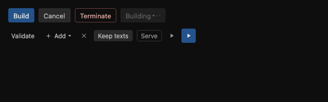
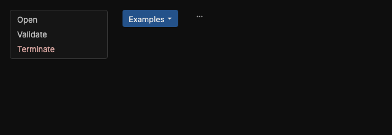
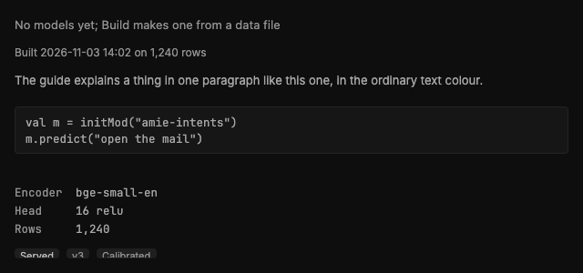
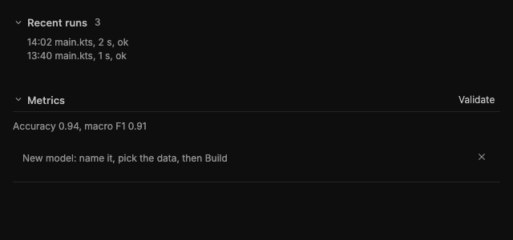
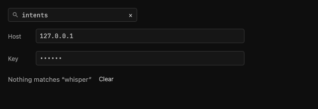
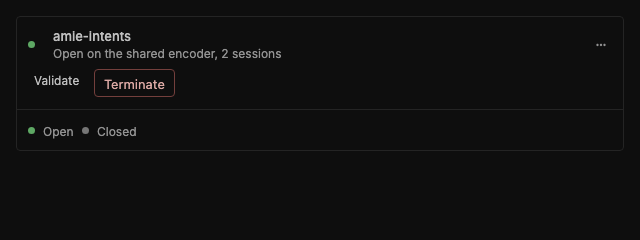
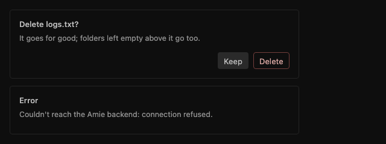
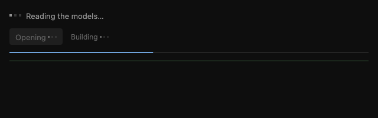

# The components

The pieces every page is built from, each in a file of its own under
`amieApplication/desktopApp/src/main/kotlin/org/example/project/components/ui/viewport/`. Use one of these before
drawing anything of your own: a page that needs a button, a menu, a hint, a fold or a two-pane layout takes it from
here, so every page looks and behaves the same. The pictures come from `ui/ComponentShotsTest.kt`, which draws each
family with plain data (`AMIE_COMPONENT_SHOTS=<dir>` writes them; the test runs without it).

The rules they all follow are in `LONG_RUN_PROMPT.md`, Appendix C: flat, square (4px corners), muted colours from
`ui/theme/Color.kt`, a tooltip on every control, text with a capital first letter and never in capitals.

## Colour

Every colour is a token of `ui/theme/Color.kt`; no page names one of its own. The chrome is neutral gray, three steps
darker than the JetBrains dark theme, and three hues sit on it as accents, never as floods:

| Token | Hue | For |
|---|---|---|
| `AccentColor` (`PageAccent`, `AddButton`) | Dark blue | The fill of the one primary action per place, light words on it (`OnPrimaryColor`) |
| `AccentInk` (`AccentLine`, `FocusRingColor`, `TabActiveIndicator`, `PanelEdgeSelected`, `ActiveColor`, `LinkColor`) | Blue | Lines and words that mark what is chosen, focused or under way: the focus ring, a focused field's border, the open tab's bar, a selected row's edge, a link, the line of a build or a download |
| `AccentWash` (`PanelSurfaceSelected`, `CompletionSelected`) | Blue, faint | What is selected sits on it: a row, the open page in the sidebar, the lit line of a list; `EditorSelection` is the editor's own, a step stronger |
| `SuccessColor` (`RunIconColor`) | Green | What runs, succeeded or is done: a status mark, the Run icon, the bar of a notice that ended well |
| `DangerColor` (`StopIconColor`, the `DangerButton` tones) | Red | What ends, removes or failed |

A hover is a gray shade (`HoverOverlay`, `SurfaceHover`), never the wash: blue says chosen, not pointed at. `ContrastTest`
holds every pair in use (words 4.5:1, marks 3:1) and checks that the accents are blue and green and the chrome's grays
neutral, so a colour used on a new surface is added there.

## Buttons and switches: `Controls.kt`

| Component | For | Use it when |
|---|---|---|
| `AccentButton(label, tip) { }` | The one primary action of a place: Build, Run, Save. The only filled button, dark blue | A place has one action that matters most; never two accents side by side |
| `SecondaryButton(label, tip) { }` | The neutral action beside an accent or a danger button: Cancel, Keep | The person can back out, or there is a second way that changes nothing |
| `DangerButton(label, tip) { }` | What ends or removes something: Terminate, Delete, Destroy. Outlined in red | The action cannot be undone or ends a session; the menus colour the same words red |
| `SmallButton(label, tip, icon, arrow) { }` | The small ghost button for everything else: Validate, Add, Show the rows | An action of a row or a header; `arrow = true` when it opens a menu |
| `CloseButton(tip) { }` | The ✕ that closes a panel or a form; an ordinary ghost, never red | Closing ends nothing |
| `Toggle(label, on, tip) { }` | What is on or off: Keep texts, Serve | A setting with two states; `outlined` draws a border where it stands alone |
| `IconChip(icon, tip) { }`, `AccentIconButton(icon, tip) { }` | A small square with only an icon: the sandbox's Run, Stop and export (16px outlined icons, `iconSize = 16.dp`), a filter's clear | There is no room for a word and the tip says what it does |

A button whose work is running reads as its own word with an ellipsis, `Building…`, is disabled until it is done and
draws the loading dots after the word (`BusyLabel`, in Loading.kt).

## Menus: `Menus.kt`

| Component | For | Use it when |
|---|---|---|
| `MenuBox(items) { close }` | The dark box with one line per action, the ending ones (Terminate, Delete, Remove, Stop, Detach) in red | A right-click or a ⋯ opens the actions of an item; `MENU_HEADING` starts a line that only names a group |
| `DropButton(label, items, tip)` | A button that opens a MenuBox under itself, right edges aligned (`BelowButton`) | A list of things to pick from, as the sandbox's Examples |
| `MoreButton(items)` (in `Panels.kt`) | The ⋯ at the right of a detail header, with the same actions a right-click opens | A detail panel has actions beyond its buttons |

A page that wants the keyboard back after a menu closes gives a `MenuWatcher` through `LocalMenuWatcher`.

## Tooltips: `Tooltip.kt`

`AppTooltip(text) { content }` shows a short explanation under the pointer after it rests half a second on the
content: what a button does, or what a tab holds. Every control above takes its `tip` and wraps itself in one; use it
directly for anything else that needs a word, such as a status dot or a tab. A null text shows the content as it is.

## Text pieces: `Texts.kt`

| Component | For | Use it when |
|---|---|---|
| `Hint(text)` | One muted line that says what is going on or what to do: "No models yet; Build makes one" | A list or pane has nothing to show, or something needs a word of guidance |
| `Meta(text)` | One small muted line of facts: when it was built, on how many rows | Facts under a name or a title |
| `Para(text)` | A paragraph of the guide in the ordinary text colour | Explaining something in full sentences |
| `Lines(vararg lines)` | A few lines a script would hold, in the console's box so they can be selected and copied | Showing code the person may copy |
| `KeyValues(pairs, tips, varying)` | Aligned `key: value` lines in monospace; keys in `varying` are marked as of this run | Details of a model or a session |
| `BadgeLabel(text, strong)` | A small label on a faint square: Served, v3, Calibrated | A state worth a glance in a list row |
| `Modifier.variesByRun()` | Marks what differs from run to run, so a screenshot compare skips it | A time, a count or a memory figure in a page the harness photographs |

## Sections and folds: `Sections.kt`

| Component | For | Use it when |
|---|---|---|
| `Fold(title, count, open, key) { }` | A section that opens on click: chevron, title and count in the header | Content worth hiding by default, as the sandbox's Recent runs; `openNow` opens it from elsewhere |
| `Section(title, key, actions) { }` | A block of a detail tab: the title on a line that folds it away (open by default), a rule, the content | A tab holds several blocks, each with a name |
| `FormHeader(hint, onClose)` | The first line of a form: what the form does and the ✕ that leaves it | A form opens inside a page, as New model does |

## Fields: `Fields.kt`

| Component | For | Use it when |
|---|---|---|
| `SearchField(value, tip, list, name) { }` | A one-line filter over a list: icon, text and a clear button once there is text | A list is long enough to filter; `list = true` for the one ⌘F reaches |
| `SettingField(label, value, tip, masked) { }` | A labelled one-line input: Host, Port, a key (`masked`) | A setting the person types |
| `NoMatches(query) { clear }` | Says a filter left nothing, with the query, and clears it | Under a filtered list that is empty |

## Panels and the detail layout: `Panels.kt`

| Component | For | Use it when |
|---|---|---|
| `DetailPanel { }` | The bordered panel of the selected item, at the right of a list | A page is a list and the detail of what is selected (Models, Packages, Sessions, Settings) |
| `DetailHeader(name, active, status, statusTip, menu) { actions }` | Name and status on the left, the actions on the right (or under, when narrow), then the ⋯ menu | The first thing in a DetailPanel |
| `StatusMark(active, tip)` | A 7dp dot: green while active, gray when not | A row or a header says whether something runs |
| `ListRow` (in `Panels.kt`) | A row of a list: its icon, name, meta line and status; selected, it sits on the blue wash with a blue edge | Every list of the Models page |
| `VerticalSeparator(onWidth)` | The rule between the list and the detail, dragged to change the split | Between the two panes |

## Dialogs: `Dialogs.kt`

| Component | For | Use it when |
|---|---|---|
| `ConfirmBox(title, confirm, onConfirm, onKeep, text, keep)` | A question that stands in the page, under what it is about: Keep first, the action last | Before anything that cannot be undone |
| `DialogCard(title, text) { buttons }` | The shared card: a title, a line under it, the buttons at the right | Any message that stops the person |
| `ErrorDialog(title, message, onDismiss)` | The card floating over the window with one OK | An error the person must see before going on |

They share one width (`DialogWidth`), one title line and one button height, checked by `ui/DialogShotsTest.kt`.

## Loading: `Loading.kt`

The one way the app waits. Nothing in it shows before about 150 ms have gone by, so a fast read never flickers.

| Component | For | Use it when |
|---|---|---|
| `Loading(text)` | The place of a pane or a list that is still reading: the dots and words saying what is waited for | State that starts null or empty and is filled by a `LaunchedEffect` or a poll; a list says "Reading the models…" until its first read, never "No models yet" |
| `LoadingContent(loading, text) { }` | Crossfades from the wait to the content once it is there | A pane whose content replaces the wait in one piece |
| `BusyLabel(label, color)` | A button's or a row's label while it works, the dots alive after the word | The four text buttons draw their label with it: a label that starts with an -ing word and ends in … ("Opening…", "Reading the queue…") is busy by itself. Any other ellipsis says a dialog follows ("Fine-tune on file…", "Export…") and is drawn still (`isBusyLabel`) |
| `LoadingDots(color, size)` | The dots alone | A line of the console (its last line while the run is busy, when it ends in …) or a strip |
| `ProgressLine(fraction, color)` | The thin two-dp line of a run or a build: filled to `fraction`, or sweeping when the work can't say how far it is | Under the console strip, the build line of the Models list, a package being added |

Every wait in the app uses these: the lists of the Models page before their first snapshot, the sandbox's editor and
Recent runs before their files are read, the console while a text model loads or the builder embeds and fits, the
settings' file tree, the package repository's search, and the window before the sandbox has taken over.

## The frame of the window

| Component | File | For |
|---|---|---|
| `NavigationSidebar(...)` | `NavigationSidebar.kt` | The column at the left of every page: the sandbox, the models page, the settings gear and the page's own tools, each a `SidebarItem` with its tip |
| `WindowHeader(name, onBack) { tools }` | `WindowHeader.kt` | The window's top bar, which is the page's toolbar: back, the page's `tools` (the sandbox's script and Run, the Models tabs, the Settings sections), an optional add button and the window controls (on a Mac room for the system's three instead); it is the drag area, with no title. `BarTab` is a tab in it |
| `StatusStrip()` | `StatusStrip.kt` | The strip at the foot: the process's memory, the heap and the encoders in memory, read every two seconds while it shows |
| `ThinScrollbar(scroll)` | `ThinScrollbar.kt` | The thin bar at the side of what scrolls, dim until the pointer is on it |
| `Modifier.tracksFocusVisibility`, `FocusRing` | `FocusRing.kt` | The 1dp ring a control shows while the keyboard put the focus on it |
| `LocalAppChrome` | `AppChrome.kt` | What the window gives the header: the drag area, the window controls, and `systemControls` when the system draws its own |

The lists of the device dashboard (`DataEntryList.kt`, `EndpointEntryList.kt`, `DevicePanel.kt`) are of that page
alone and are not reused.

## Beyond the viewport

- **Helpers under `components/terminal/window/controller/util/`**: `Desktop.kt` (`chooseFile`, `openInBrowser`,
  `openFile`) and `Numbers.kt` (`fmt`, `pct`) are the plain functions pages share; they draw nothing.
- **The console** (`console/`), **sessions** (`modules/ModelSessions.kt`, `tabs/SessionsTab.kt`) and the script API
  (`initMod`, `sessionMod`, `ortClosable` in `script/ScriptLogger.kt`) are documented where they live, with KDoc on every
  member a script can call; [Scripting API](sandbox-scripting.md) lists them for a script writer.
